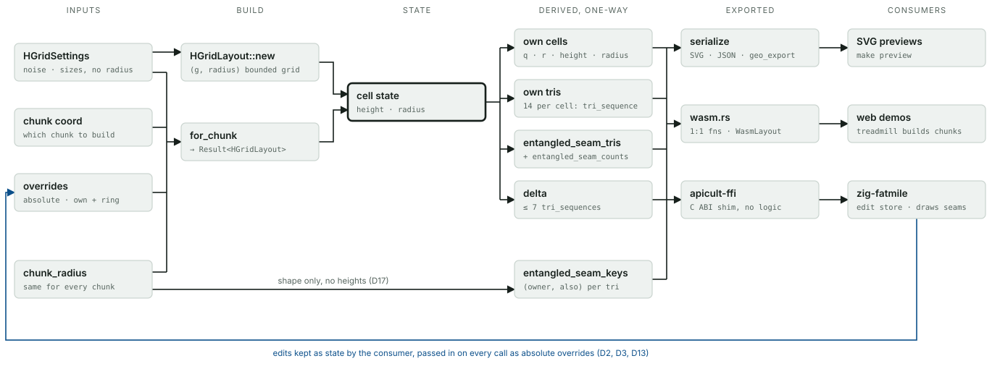

# Design note: cell state first

Target API for epic #39. The decisions come from #29, #37 and #38 (D1–D8 in #38, D9–D19 in #29's comments). This note is the agreed version. Change it when a decision changes, and update the flow chart with it.

## Principle

- Cell state (`height`, `radius`) is the source of truth.
- Edits made while a game runs are kept as state. This is paramount.
- Triangles are a one-way serialization of state. They can't give the state back.

`entangled` is not state: it is derived from a cell's position (D9).

## Target rules (#38)

1. A consumer's FFI is a C ABI over apicult calls, with no geometry or grouping logic of its own.
2. Chunking returns an `HGridLayout` (state) before any tris are made.
3. Tri generation takes a layout as input.
4. When a cell is dug, apicult answers with a mesh delta.
5. Tri output is a plain dump with no relationship data. Relationships are queries.

## Terms

| term | meaning |
|---|---|
| own cells | the radius-`chunk_radius` hexagon of cells with `hex.to_lower_res(chunk_radius) == coord` |
| `entangled_ring` | the cells at distance `chunk_radius + 1` from the chunk centre. Every chunk layout holds them, so the gaps along its edge have both sides. Each one is an own cell of its own chunk and sits in the entangled ring of 1 or 2 others (chunk edge or corner); it is never state in those |
| `is_entangled(h)` | `center.unsigned_distance_to(h) == chunk_radius + 1`. Replaces the `HexCell.entangled` field |
| `tri_sequence` | the 14 tris an own cell owns: 6 face, 6 gap-quad (3 quads), 2 junction. Replaces "run" (`owned_runs`, `first_tri`). `TriSequence` (type), `triSequence` (JS, Zig) |
| `entangled_seam_tris` | the tris the entangled ring gives a chunk: per entangled cell, its quads, then its junctions |
| `entangled_seam_counts` | per entangled cell, its count of quad tris, then of junction tris |
| `EntangledSeam` | a seam key `(owner, also)`. `also` is the third chunk a junction tri touches, or none |

## Decisions

### Layout and state

- **D1, stateless calls.** There are no Rust-side handles across the FFI. Each call builds a layout from settings, coordinate and edits, and returns. A whole chunk (`chunk_radius` 6) takes 0.22 ms.
- **D2, the consumer stores edits.** zig-fatmile keeps `hex → height`, keyed by owning chunk, and passes a chunk's own and entangled-ring edits on every call. apicult stays pure: noise + given state → layout → tris. Saving is the game's job.
- **D3, state goes in as an override list.** `Override = (NoiseType, Hex, f32)`, applied by `build` after sampling. It covers height and radius.
- **D12, no cell setter.** A built layout is immutable. Edits go in only through overrides, so the same inputs always give the same tris.
- **D13, an override is absolute.** It sets the final height or radius, not an offset from noise.
- **D14, two constructors, and `radius` leaves the settings.** `HGridLayout::new(g, radius)` builds a bounded grid (geo_export, the SVG previews, `WasmLayout` for the units and crawler pages). `for_chunk` builds a chunk. `HGridSettings` holds only noise and size settings, so no constructor ignores a field. #2 is amended to match and lands early (see order below).
- **D16, one entry point for chunks.** `for_chunk(g, coord, chunk_radius, overrides) -> Result<HGridLayout, ChunkError>`. `ChunkSource` and `NoiseWorld` are deleted. The consumer keeps settings and `chunk_radius` together.
- **D6, the flower demo is deleted.** `hex-terrain.html`, `hex-terrain-scene.js` and `hex-seam.js` go. So do the `entangled: bool` filter on every geometry method and `new`'s `overrides` / `entangle` lists (#24).

### Tris

- **D4, the dump: cells, flat tris, entangled seam counts.**
  - The own cells' state `(q, r, height, radius)`, in `shapes::hexagon(center, chunk_radius)` order.
  - Own tris: cell *i* owns `tris[14·i .. 14·i + 14]`. Own cells always have all their neighbours, so this holds for every own cell. apicult documents and tests it as an invariant.
  - `entangled_seam_tris` in `center.ring(chunk_radius + 1)` order, with `entangled_seam_counts` (two per entangled cell: quad tris, then junction tris).
  - No byte format or hash in apicult.
- **D15, `Chunk` is deleted.** The dump is a set of functions of a layout: `own_cell_states`, `own_tris`, `entangled_seam_tris`, `entangled_seam_counts`. Each consumer assembles its own bundle.
- **D10, the seam cut is its own rule.** Today the `entangled` filter makes the cut: `owned_tris_into(h, false, …)` on an entangled cell drops its face fan and the quads between two entangled cells, and the layout ends at `chunk_radius + 1`. After D6 the rule is stated directly: *an entangled cell emits only the quads and junctions that touch an own cell.* At `chunk_radius` 6 the 42 entangled cells emit 0 face, 78 quad (39 quads) and 40 junction tris. Of the 78 quads between the ring and the chunk, the ring owns those 39 and the own cells own the other 39.
- **D5, a stateless delta.** `delta(g, coord, chunk_radius, overrides, hex) -> Result<Delta, ChunkError>` (and `HGridLayout::delta(hex)`) returns the `TriSequence { cell, offset, tris }` runs of the changed cell and its 6 neighbours: `Delta.own` (≤ 7 × 14 own tris at offsets 14·i) and `Delta.entangled_seams` (any entangled seam tris they own, at their offsets in `entangled_seam_tris`), built by the same code as the full chunk. A height or radius edit keeps the topology, so the consumer overwrites those ranges in place. An edit on a chunk's edge or corner also changes the 1 or 2 neighbour chunks holding the cell in their entangled ring: the consumer calls `delta` for each. No reactive or observer plumbing.

### Seams

- **D17, `entangled_seam_keys(coord, chunk_radius)`.** A pure function: one `(owner, also)` per entangled seam tri, parallel to `entangled_seam_tris`. Which tris exist depends only on the chunk shape, not on heights, so no layout is built. It takes `coord` and returns absolute keys (amended from relative keys, which every consumer would have had to shift itself). It shares the ownership rules with `owned_tris_into` through one function, so consumers never copy the corner-0/1 rule.
- **D7, one draw rule with a shared test table.** `key.drawn(carrier, loaded)` on an `EntangledSeam` key is a pure function over hex coordinates: draw while the owner isn't loaded, and `also` isn't loaded or sorts after the carrier in `(q, r)` order (#27). A table of test cases lives in the repo (`testdata/entangled_seam_drawn.tsv`, exported as the `ENTANGLED_SEAM_DRAWN_TABLE` string so a dependent crate can check its copy). zig-fatmile's port and the treadmill's JS are tested against the same table.

### Errors, exports, process

- **D8, `Result` everywhere.** `for_chunk`, the dump functions and `delta` return `Result<_, ChunkError>`. The remaining `expect`s become errors. The C ABI turns an error into null plus an error code (zig-fatmile parks that chunk in `TerrainStream.broken`).
- **D18, the treadmill assembles chunks in JS.** `wasm.rs` exports the free functions one to one, and `WasmChunk` goes. `hex-stream.js` builds its seam groups from `entangled_seam_tris` and `entangled_seam_keys`, under node tests. Other demo packing (54-float `face_tris`, 78-float `face_bridge_quads`) also lives in the wasm or JS layer, not in `layout`.
- **D11, the golden checksum is bridged.** A second checksum, in its own PR (#39 step 2), hashes one `for_chunk` chunk: each own cell's 14 tris in `shapes::hexagon` order, then `entangled_seam_tris` in `center.ring(chunk_radius + 1)` order. #39 step 4 deletes `all_tris_golden_checksum`, which D6 would otherwise change without any change to the geometry.
- **D19, this note lives here.** `docs/design/cell-state.md`, with the flow chart as `cell-state-flow.svg`, linked from CLAUDE.md.

## Order of work

The steps of #39:

1. #29: this note.
2. The D11 checksum PR.
3. #2 (`NoiseParams`), with D14's amendment.
4. `for_chunk` with overrides (D3, D8, D16), the flower deleted (D6), `entangled` derived from position (D9).
5. The seam cut as functions of a layout, by hex coordinates (D10, D17, D7).
6. The dump (D4, D15), closing #37. `Chunk`, `ChunkSource`, `NoiseWorld` and `WasmChunk` go (D16, D18).
7. `delta` (D5), tested against a full rebuild bit for bit.
8. zig-fatmile's `apicult-ffi` down to a C ABI shim, then bump its pinned rev.

The D11 checksum stays green from step 2 on, and `all_tris_golden_checksum` until step 4 deletes it. Each step's PR adapts the demo pages it touches, and the JS tests stay green.

## Not in scope

- #7 (a `TriStream` trait): waits for a second geometry producer.
- #18 (CLI chunk export): closed; zig-fatmile builds chunks at runtime.
